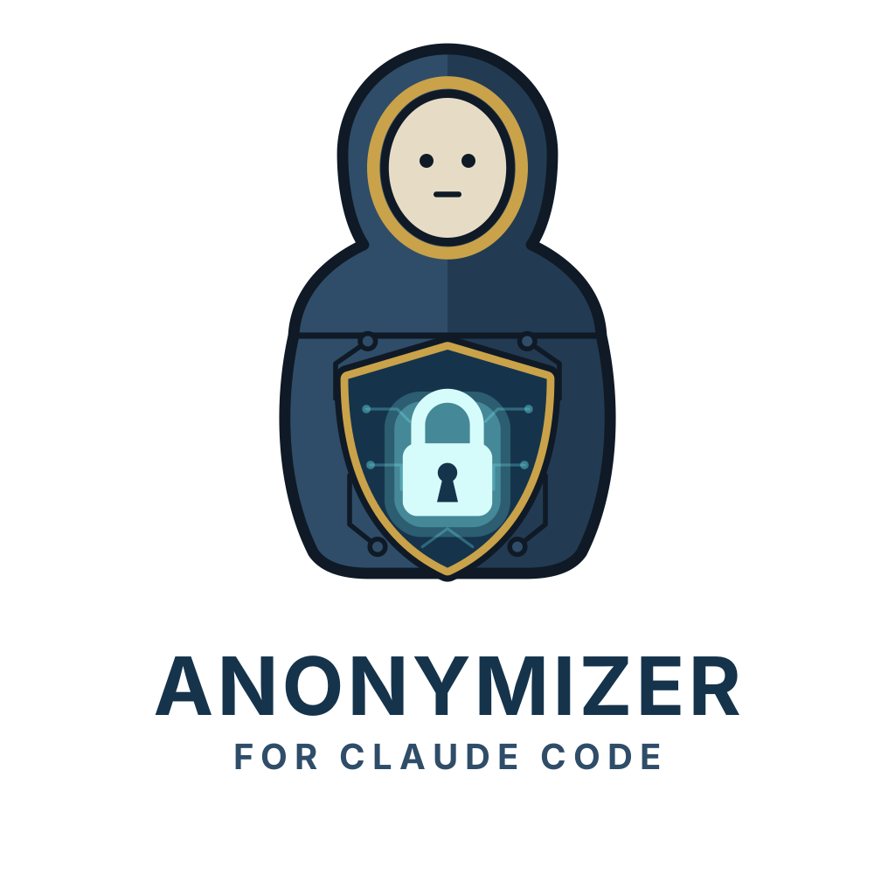

<p align="center">
  <picture>
    <source media="(prefers-color-scheme: dark)" srcset="assets/logo-dark.png">
    
  </picture>
</p>

# Anonymizer for Claude Code

A plugin that anonymizes Excel (`.xlsx`, `.xlsm`), CSV, TSV, JSON, JSONL and YAML files **on your
machine** before Claude sees them. The model only receives a value-free column profile and, once you
approve the plan, an anonymized and verified copy.

> **v0.2, preview release.** Covered by automated tests, five rounds of adversarial review and real
> use in Claude Code (macOS). Still pending: the automated attack battery across the four permission
> modes (`canaries/attacks.py`) and testing on Linux. Threat model and guarantee in
> [specs/001-data-never-reaches-the-model.md](specs/001-data-never-reaches-the-model.md); limits in
> [SECURITY.md](SECURITY.md).

## Install

Requirements: Claude Code 2.1.275+, Python 3.10+ with `venv`, and macOS or Linux (on Linux,
`sudo apt install bubblewrap socat` for the sandbox; on Windows, use WSL2). The first session needs
internet access to install its dependencies (openpyxl and PyYAML, pinned by hash).

```bash
claude plugin marketplace add EDUERDEJESUSJARAMILLOBALBIN/claude-anonimizador
claude plugin install anonimizador@anonimizador
```

Or inside a session: `/plugin install anonimizador --marketplace EDUERDEJESUSJARAMILLOBALBIN/claude-anonimizador`

Then, once per computer, inside Claude Code:

```text
/anonimizador:setup
```

Claude gives you a single command to type in the chat (`! ".../run.sh" install`). That command turns
on the operating system sandbox with the plugin's rules, creates `~/sensibles` and `~/anonimizados`,
backs up your `~/.claude/settings.json` and deletes nothing of yours. Restart Claude Code and confirm
with `/sandbox`. To undo it: `! ".../run.sh" uninstall`.

If one of your projects uses CSV, `.sql` or SQLite files without personal data (fixtures,
`structure.sql`, `development.sqlite3`): `/anonimizador:allow ~/path/to/project`.

**Check that it protects you:** create any `~/Downloads/test.csv` and ask Claude to read it. It must
answer with a block that starts with "Anonymizer:".

## Use

1. Put the original file in `~/sensibles/`.
2. Ask Claude `/anonimizador:anonymize ~/sensibles/sales.xlsx to see sales by city`
   (or just "analyze ~/sensibles/sales.xlsx": the skill triggers on its own).
3. Claude shows you the profile, suggests which columns to drop for that analysis and asks you.
4. You approve the plan in the permission dialog.
5. Claude works with `~/anonimizados/sales.anon.xlsx`.

## What it protects and how

| Layer | What it does |
|---|---|
| MCP server `profile` / `apply` | The only door to the original; its answers go through a closed, value-free contract, and it only shows headers from a known vocabulary |
| Copy from scratch + verification | No hidden sheets, comments, metadata or formulas; if a value from the original is left in any byte, it is erased |
| PreToolUse hook | Allowlist: no data file outside `~/anonimizados` (Read, Grep, Edit, third-party MCP, `file://` URLs, uppercase, symlinks, hard links, wildcards). Without a configured sandbox, Bash stays closed |
| PostToolUse hook | Redacts values from the original in any output (backup) |
| UserPromptSubmit hook | Blocks `@data-file` and pasted text with values from the original or with several emails/phone numbers |
| SessionEnd hook | Audits the transcript and warns in `~/.anonimizador/alerts.log` |
| `/anonimizador:setup` | OS sandbox with per-extension `denyRead`: closes what a hook cannot see (a path built inside a script). Required |

Pseudonyms use HMAC-SHA256 with a key in the macOS Keychain: the same value gives the same `ID_…`
across all your files, and nobody can reverse it without your Mac.

## Known limits

- JSON, YAML and XML are closed only where files arrive (Downloads, Drive, iCloud, Mail, external
  drives) and in `~/sensibles`; in your projects they are configuration and stay open. TXT is not
  protected.
- In JSON and YAML, a key that is not known vocabulary leaves the copy as an alias (`k1`, `k2`…), the
  same as an unknown spreadsheet header: a map keyed by person (`{"ana_ruiz": {...}}`) keeps its shape
  without the names. An object or list inside a list of values is pseudonymized as a whole or dropped,
  never kept. Two keys that are the same text (`1` and `'1'` in YAML) make the file be rejected.
- Archives (`.zip`, `.gz`, `.tar`, `.7z`…) and ML/statistical binaries (`.sav`, `.dta`, `.rds`,
  `.pkl`, `.npy`, `.parquet`…) are closed only where files arrive: Downloads, Google
  Drive/OneDrive/Dropbox, iCloud, Mail attachments and external drives. An export usually arrives
  compressed. In Documents, Desktop and your projects they keep working.
- Third-party MCP tools that run code or queries (`run_code`, `run_cell`, `*_sql`…) or that search and
  read files from an index (`search_code`, `get_code_snippet`, `read_multiple_files`…) are blocked; if
  you trust one, add it to `~/.anonimizador/config.json` as `"trusted_mcp_tools": ["mcp__server__tool"]`.
  Tools are recognized by name: a third-party MCP server that reads local files under an unusual name
  is outside what the plugin can tell apart. Install only MCP servers you trust.
- Claude does not edit Claude Code settings, hooks, skills, commands, agents, `.mcp.json` or
  `~/.claude.json` from a session, with its own tools or a third-party MCP: what they run is outside
  the plugin's reach. Edit those files yourself. Instruction files (`CLAUDE.md`, rules) stay editable.
- An MCP server with its own access to a database (a CRM, a Postgres) is out of scope: the plugin
  protects files, not services you connect.
- Against a malicious repository, only managed settings protect you (`run.sh config managed`): a
  repository can turn the plugin off from its settings or, if Claude Code passes its environment
  variables to hooks, run code when the shell starts, before the plugin can check anything.
- The tripwire reveals, at most, in which session output the first value appeared before locking the
  session; and it only fires on values that identify someone on their own (a name of two or more
  words, an email, a number of 7+ digits), so a "Maria" in a `git log` does not lock you out.
- SQLite databases are covered only by the hooks, not by the sandbox (Rails and Django read them on
  their own).
- Commands in `sandbox.excludedCommands` run outside the sandbox: every one you add is a hole.
- In your projects, Claude cannot read test CSV or `.sql` files; open those folders with
  `/anonimizador:allow` (stored in `~/.anonimizador/config.json` as `"allowed_dirs"`) if they hold no
  personal data.
- Commands you type with `!` go through neither hooks nor sandbox: do not run them on originals.
- Name detection inside free text is limited; by default those columns are dropped.
- Formats anonymized today: `.csv`, `.tsv`, `.xlsx`, `.xlsm`, `.json`, `.jsonl`, `.yaml`, `.yml`.
  Pending: `.xls`, `.ods`, `.xml`, `.sql` dumps, SQLite.
- The engine does not run in a network-less Docker container yet.

## Development

```bash
python3 -m venv engine/.venv && engine/.venv/bin/pip install -e 'engine[dev]'
engine/.venv/bin/pytest -q engine

# Canary files and audit (they never print values)
engine/.venv/bin/python canaries/generate.py canaries/out
engine/.venv/bin/python canaries/audit.py canaries/out/manifest.json
```

## License

MIT
